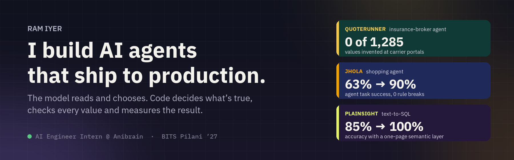
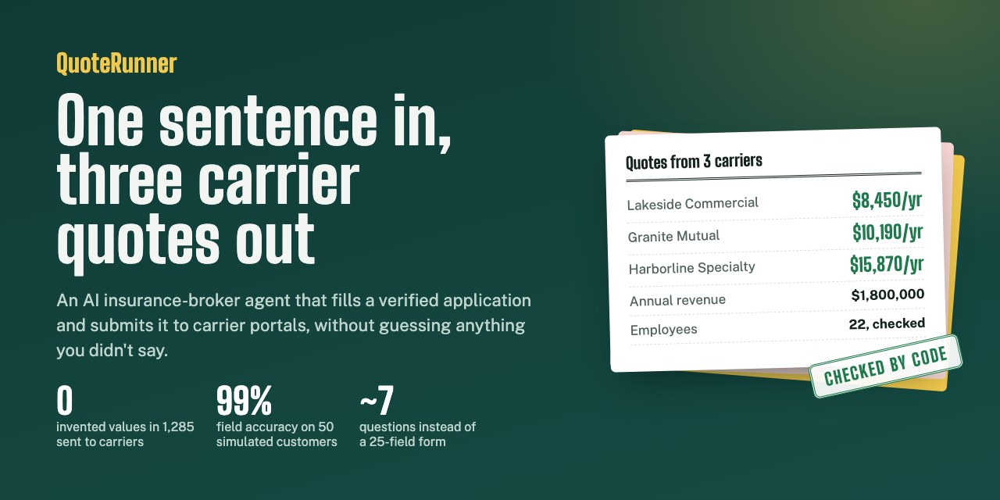
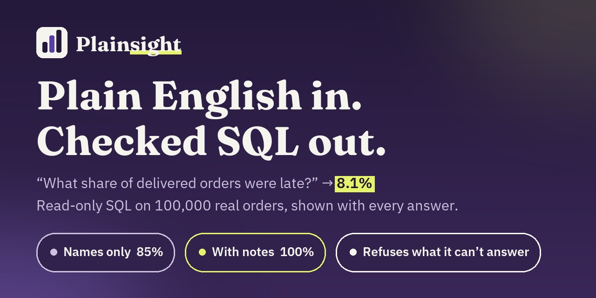

  <a href="https://quoterunner.ramiyer.tech"><b>QuoteRunner</b></a> ·
  <a href="https://jhola.ramiyer.tech"><b>Jhola</b></a> ·
  <a href="https://plainsight.ramiyer.tech"><b>Plainsight</b></a> ·
  <a href="https://www.linkedin.com/in/iyer-ram/">LinkedIn</a>

I build AI agents and the systems around them: the evals that measure them, the guardrails that keep them honest, and the data pipelines, integrations and servers they run on. Three of them are live on my own server, each with its evaluation in public.

The rule that runs through all of it: **the model reads and chooses; code decides what's true.** Prices, totals, every value sent to an insurance carrier, and whether a query may run at all are computed and checked in tested code, never taken on the model's word.

<table>
  <tr>
    <td align="center" valign="top" width="25%"><h3>3</h3>AI products live on my own Linux server</td>
    <td align="center" valign="top" width="25%"><h3>652</h3>automated tests across them, run in CI on every PR</td>
    <td align="center" valign="top" width="25%"><h3>5</h3>eval suites that score the real model; two projects gate PRs on them</td>
    <td align="center" valign="top" width="25%"><h3>0</h3>values invented in 1,285 sent to carrier portals</td>
  </tr>
</table>

## Shipped

### [QuoteRunner](https://github.com/iyerbrah/QuoteRunner) · AI insurance-broker agent

A small business describes itself in one chat message; QuoteRunner asks only for what's missing, fills a verified ACORD 125-style commercial insurance application, submits it to three simulated carrier portals in parallel and brings back the quotes, cheapest first.

- **Carrier-portal integration:** reads each portal's HTML form, maps fields by 2-of-3 LLM consensus (names only, never values) and caches the mapping by form hash. **1,285 of 1,285 values correct across 252 submissions, 0 invented.**
- **The model reads, code decides:** forced tool-call extraction, Pydantic validation and no-guess rules in code decide every value a carrier receives.
- **Measured with 50 simulated customers** in 7 speaking styles: **99.3–99.8% field accuracy**; transcript-driven fixes took completion from 78% to 90–98%.
- About **$0.003 a conversation**, with per-call tracing and spend caps; 193 tests and an eval gate on every PR.

`Python` `FastAPI` `OpenAI` `Pydantic` `SQLite` · [Live](https://quoterunner.ramiyer.tech) · [Eval results](https://quoterunner.ramiyer.tech/evals) · [Code](https://github.com/iyerbrah/QuoteRunner)

 

### [Jhola](https://github.com/iyerbrah/Jhola) · AI agent that builds your grocery cart

Say what you need, like "pasta night for 4, vegetarian, around ₹600" or "snacks for 10 kids, no nuts", and a tool-using agent builds one ready cart of groceries and household items from 3,309 real products, then changes it by chat ("make it 6 people", "no dairy") or by tap. A free demo: no real orders, no payment.

- **The model reasons, code guarantees:** the agent writes intent (a brief and the needs) through 9 strict, Zod-checked tools; a solver in TypeScript picks products, packs and prices, with an exact knapsack for budgets. **100% valid carts over 3,000 random sessions, 0.5 ms a solve**, and an independent checklist re-checks every turn.
- **Measured on 105 scripted chats** against the real model, checked in code with no AI judge: **91–96 pass across the last two runs, with 0 rule breaks and 0 prompt injections obeyed**, and edits change only what was asked. Moving scope, budget and diet edits into code took task success from 63% to 90% on the first 29-chat eval.
- **Fast and cheap:** code ends a clean turn and writes the reply itself, so most turns take one or two model calls, about **$0.009 a turn** and 5.4 s median; taps on the cart need no model at all.
- Every turn logged in PostgreSQL with per-call traces, public [Results](https://jhola.ramiyer.tech/results) and [History](https://jhola.ramiyer.tech/history) pages computed in SQL, 355 tests, and a real-model eval check on PRs.

`TypeScript` `Next.js` `OpenRouter` `Zod` `PostgreSQL` `Redis` · [Live](https://jhola.ramiyer.tech) · [Results](https://jhola.ramiyer.tech/results) · [Code](https://github.com/iyerbrah/Jhola)

 

### [Plainsight](https://github.com/iyerbrah/Plainsight) · text-to-SQL you can check

Plain-English business questions become one read-only SQL query over 100,000 real e-commerce orders, and every answer shows its query, in a median 1.8 s at about $0.0015 a question.

- **What makes it right, measured:** on 60 hand-checked questions scored on results (not SQL text), a one-page semantic layer took accuracy from **85% to 100%** (hard questions 7/15 → 15/15). It held on DeepSeek (83% → 98%); few-shot examples added nothing and caused a new error.
- **Model output treated as untrusted input:** a sqlglot single-SELECT allow-list, a read-only database, 15 s and 1,000-row caps, and **17 attack tests**. It refused all 10 questions the data can't answer.
- 104 tests in CI; every merge to `main` deploys itself in about 14 s.

`Python` `FastAPI` `DuckDB` `sqlglot` `OpenAI` · [Live](https://plainsight.ramiyer.tech) · [Scorecard](https://plainsight.ramiyer.tech/scorecard) · [Code](https://github.com/iyerbrah/Plainsight)

 

## At work

**AI Engineer Intern · Anibrain Digital Technologies** · Pune · Jul 2026 – present

- **SocialSync**, in production with the marketing team: publishes to 5 social platforms through their OAuth APIs, with scheduling, validation and retries.
- **Image Studio**, in production with the design team: turns raw product photos into publish-ready posts and carousels, with a Canva integration and per-image cost and latency tracking.
- **One pipeline from photo to post:** joined the two so a raw product photo becomes a marketing asset that's scheduled and posted to 5 platforms, with no manual export.
- **A sales CRM** (PostgreSQL, Docker) used by the sales team: migrated 541 opportunities with role-based access and audited imports.

**Product Development Intern · My Learning Plus** · Hyderabad · May – Jul 2024 · Funnel analysis and A/B tests on SMB onboarding; the redesign they drove cut drop-offs by 28% and lifted CTA conversion by 34%.

## How I build

| | |
| --- | --- |
| **The model reads; code decides** | Anything that can be computed or checked is code: carrier values, prices and totals, which carts an agent may touch, whether a query may run. |
| **Measure before claiming** | Every project ships with an eval against the real model, in public: 50 simulated customers, 105 scripted agent chats, 60 checked questions, with a reason for every failure. |
| **Fix the cause, in code** | A prompt tweak that "seems better" isn't a fix. Each change is one PR with before-and-after numbers; the agent went 63% → 90% that way. |
| **Cost and latency are features** | $0.003 a conversation, $0.009 a chat turn, $0.0015 a question, with per-call tracing and spend caps. |
| **Ship like a team, own it end to end** | Small PRs, CI and eval gates, a protected `main`, automatic deploys with health checks and rollback, on a Linux server I run (nginx, TLS, systemd). |

## Also built

- **[IPL win probability](https://github.com/iyerbrah/ipl-chase-win-probability)**: ball-by-ball win probability for every IPL chase from 2008 to 2026; 82% accuracy on unseen seasons against a 56% baseline, with a leverage score for the tensest moments. `scikit-learn` `LightGBM`
- **[Recommender lift experiment](https://github.com/iyerbrah/personalisation-lift)**: what a video recommender is worth, from a randomised experiment on 1.36 million impressions; recommended videos got long views 4.6× as often as random ones. `pandas` `NumPy`

## Toolbox

| | |
| --- | --- |
| **Languages** | Python, TypeScript, SQL, JavaScript |
| **AI** | OpenAI, Anthropic and Gemini APIs; tool calling, structured outputs, agents, RAG, evals, guardrails |
| **Backend and data** | FastAPI, Next.js, REST APIs, Pydantic, Zod, PostgreSQL, DuckDB, SQLite, Redis, data pipelines, OAuth integrations |
| **Infrastructure** | Linux, nginx, systemd, Docker, GitHub Actions (CI/CD), pytest, Vitest, Git |
| **Data science** | pandas, NumPy, scikit-learn, LightGBM, experiment analysis |

**BITS Pilani, Hyderabad** · Dual degree: M.Sc. Physics + B.E. Mechanical Engineering, Minor in Finance · 2022 – 2027

**Looking for** an AI engineering internship from January 2027 where I can ship agents, integrations and data systems that people use every day. [Say hello on LinkedIn](https://www.linkedin.com/in/iyer-ram/).
